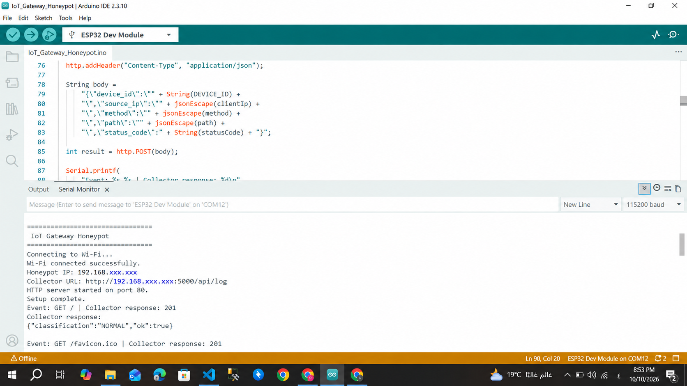
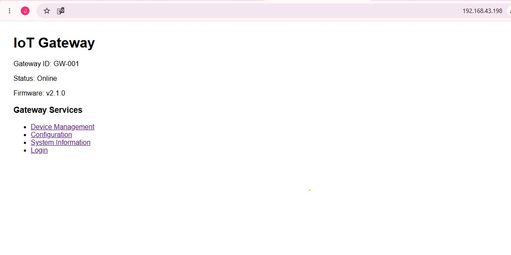
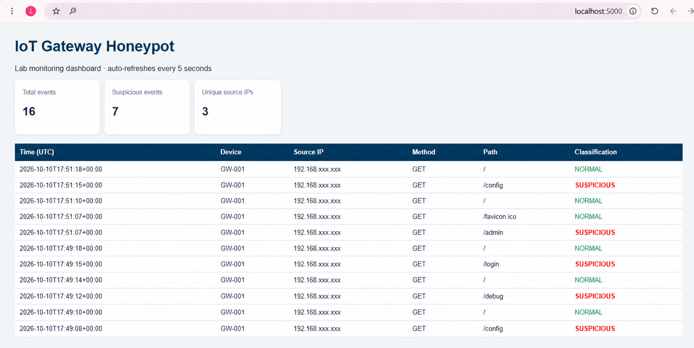

# IoT Gateway Honeypot Using ESP32

An educational IoT security prototype that simulates a gateway-like HTTP service using an ESP32. The device records requests to selected paths and forwards event metadata to a Python/Flask collector. The collector stores events in an SQLite database and displays them on a local monitoring dashboard.

> **Safety and Scope:** This is an educational prototype, not a production Intrusion Detection System (IDS) or a hardened gateway. Use it only on a private lab network you own or are authorized to test. Never expose the ESP32 service or the collector directly to the public Internet.

## Repository Layout

```text
iot-gateway-honeypot/
├── firmware/
│   └── IoT_Gateway_Honeypot.ino
├── server/
│   ├── server.py
│   └── requirements.txt
├── docs/
│   ├── architecture.mmd
│   └── screenshots/
├── README.md
└── .gitignore
```

## Project Objectives

- Simulate a simple IoT gateway HTTP interface using an ESP32.
- Record requests to selected gateway-like paths.
- Forward request metadata to a Python/Flask collector.
- Store collected events in an SQLite database.
- Display event statistics and classifications on a local dashboard.
- Demonstrate basic security-event monitoring in an authorized lab environment.

## Hardware and Software Requirements

### Hardware

- ESP32 DevKit V1 / ESP-WROOM-32
- USB data cable
- Wi-Fi router or mobile hotspot
- Laptop or computer
- Optional: breadboard, jumper wires, red LED, and a suitable current-limiting resistor

### Software

- Arduino IDE
- ESP32 board package by Espressif Systems
- Python 3
- Flask
- SQLite
- A modern web browser

## 1. Configure and Upload the ESP32 Firmware

1. Install Arduino IDE.
2. Install the ESP32 board package by Espressif Systems through Boards Manager.
3. Open `firmware/IoT_Gateway_Honeypot.ino`.
4. Configure `WIFI_SSID` and `WIFI_PASSWORD` with your lab Wi-Fi credentials.
5. Update `LOG_SERVER_URL` with the laptop's private IPv4 address. For example:

   `http://192.168.1.20:5000/api/log`

6. Select the appropriate ESP32 board and serial port in Arduino IDE.
7. Upload the firmware to the ESP32.
8. Open Serial Monitor and select **115200 baud**.
9. Confirm that the device connects to Wi-Fi and note the IP address printed in the Serial Monitor.

**Security note:** Do not commit real Wi-Fi credentials or other secrets to a public repository. Keep them in your local firmware configuration.

## 2. Install and Run the Python Collector

Open a terminal in the repository root directory.

Create a virtual environment:

```bash
python -m venv .venv
```

Activate it on Windows PowerShell:

```powershell
.\.venv\Scripts\Activate.ps1
```

If PowerShell prevents activation, you can use Command Prompt instead:

```cmd
.venv\Scripts\activate.bat
```

Install the dependencies:

```bash
python -m pip install -r server/requirements.txt
```

Start the collector and dashboard:

```bash
python server/server.py
```

The dashboard is available locally at:

`http://127.0.0.1:5000`

The collector must remain running while the ESP32 sends events. For communication between the ESP32 and the laptop, use the laptop's private LAN IPv4 address in `LOG_SERVER_URL`. Allow the Python application through the private-network firewall only if necessary.

## 3. Test in the Authorized Lab

1. Confirm that the ESP32 is connected to the same Wi-Fi network as the laptop.
2. Open the ESP32 IP address in a browser on a device connected to that network.
3. Visit the available paths:
   - `/`
   - `/admin`
   - `/config`
   - `/debug`
   - `/login`
4. Open the monitoring dashboard on the laptop.
5. Verify that new events appear in the dashboard.
6. Check the Serial Monitor for collector responses. An HTTP response code of `201` indicates that the collector accepted the event in the tested implementation.

The prototype uses simple path-based rules to classify selected paths as `SUSPICIOUS`. This is a basic demonstration, not machine-learning detection and not a complete IDS.

## 4. Verified Test Results

The following results were observed during the local lab test:

- The ESP32 connected successfully to the Wi-Fi network.
- The ESP32 obtained the local IP address `192.168.43.198`.
- The HTTP service started on port `80`.
- The gateway web interface opened successfully in a browser.
- Requests to monitored paths, including `/admin`, `/config`, `/debug`, and `/login`, were recorded.
- The Flask collector received events and returned HTTP status `201`.
- The dashboard displayed total events, suspicious events, and unique source IP addresses.

These results describe the observed test session. They do not establish that the prototype is production-ready or that every possible failure condition has been tested.

## ## 5. Screenshots

The following screenshots document the ESP32 honeypot demonstration and the monitoring dashboard.

### ESP32 Wi-Fi Connection



### Honeypot Web Interface



### Monitoring Dashboard



These screenshots provide visual evidence of the observed local lab test results.

## Architecture

The prototype consists of three main components:

1. **ESP32 firmware:** Hosts the simulated gateway HTTP interface and observes incoming requests.
2. **Python/Flask collector:** Receives event metadata from the ESP32 and stores the events in SQLite.
3. **Monitoring dashboard:** Displays event totals, suspicious-event counts, unique source IPs, request paths, and classifications.

See `docs/architecture.mmd` for the architecture diagram.

## Limitations

- This is an educational proof of concept, not a production security appliance.
- Classification relies on simple path matching and may produce false positives or false negatives.
- The prototype does not provide comprehensive network intrusion detection.
- The HTTP communication used in the lab is not encrypted.
- The development server is not intended for production deployment.
- The system has not been subjected to comprehensive security, performance, or reliability testing.

## Privacy and Security

- Do not commit Wi-Fi passwords, access tokens, or other secrets.
- Do not commit local database files, virtual environments, or unnecessary personal data.
- Treat private IP addresses and screenshots according to your institution's privacy requirements.
- Use only devices and networks you own or are explicitly authorized to test.
- Keep the ESP32 and collector on a controlled lab network.
- Do not expose the prototype directly to the public Internet.

## Project Status

The prototype has been implemented and demonstrated in a local lab environment. The ESP32 web interface, event forwarding, and dashboard were observed working during testing.

Further development would be required before the system could be considered suitable for broader deployment.

## Author and Academic Use

This project was developed for educational purposes as part of an IoT security project. Update this section with the team members, course, instructor, and institution details if required by the submission guidelines.

## License

This project is intended for educational and research use. Add a formal open-source license if distribution under specific license terms is required.
